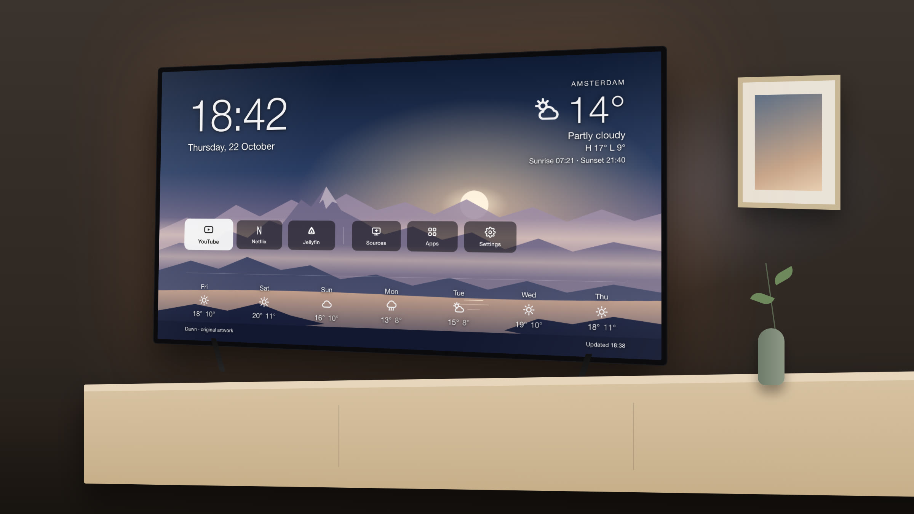
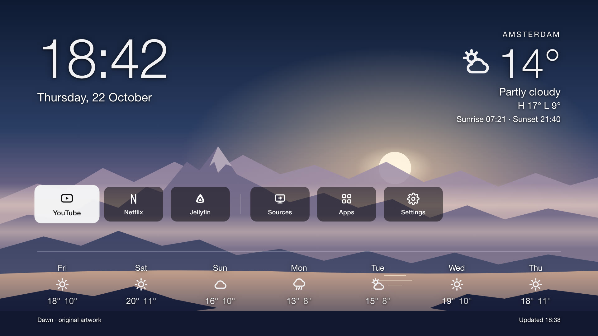

# TizenZen

**A calm, ad-free home screen for Samsung TVs. Your AI assistant installs it in minutes.**

Samsung's home bar is full of ads, sponsored rows and "Top picks". TizenZen replaces what you see
with a clock, the weather where you live, your apps, and slow aerial video in the background.
No ads, no tracking, nothing to sign in to.

It is a normal TV app plus a small background service. It does not root, flash or modify the TV,
and you remove it like any app.

---

## For people

**Ask your assistant.** Open Claude Code (or another coding assistant with a terminal) on a computer
on the same network as the TV, and paste:

> Set up TizenZen on my Samsung TV: https://github.com/&lt;owner&gt;/tizenzen. Follow AGENTS.md.

It finds the TV, tells you the two things you need to do with the remote (turn on Developer Mode,
and once press Power), installs, and tests everything itself.

**What you get**

- **Clock and weather.** Today big, the next seven days small. Free weather data, no account.
- **Your apps** as tiles. Pick them in one settings file.
- **Sources**: your HDMI devices open full screen *inside* TizenZen; Back brings you home.
- **Apps**: a short list of your other apps (Samsung blocks apps from opening its own Apps screen).
- **Settings**: Samsung's settings menu, on top of TizenZen (needs the optional helper, see below).
- **Comes back by itself**: when the TV wakes, and when you close an app.
- **Sunset dim**: the screen gets darker and warmer after sunset.
- **Aerial videos** (optional, yellow button): Apple's TV screensaver aerials, streamed. The night set
  shows cities and auroras from space.

**Limits, honestly**

- The **Home button inside YouTube** still shows Samsung's bar. Samsung gives apps no way to notice
  it. **Long-press Back** closes YouTube and TizenZen is back in about 2 seconds.
- Samsung's own menus can't be changed, only skipped.
- Apps are deleted on the TV, not by the assistant (Samsung refuses it over the developer connection).
- Tested on a **2020** TV (Tizen 5.5). Newer TVs should work but may need a Samsung developer
  certificate. See [Tested TVs](docs/MODELS.md), and add yours.

## For Claude (and other assistants)

Start with **[AGENTS.md](AGENTS.md)**: the full playbook, written by Claude after doing this the long
way on a real TV. Then **[docs/PITFALLS.md](docs/PITFALLS.md)**: 13 places where the obvious idea
fails on Tizen, each with the symptom, the cause, the fix and a command to check it yourself.

What is in the box:

| Path | What it is |
|---|---|
| `app/` | The TV app (HTML/JS, runs on Tizen 5.5+) and its background watcher service |
| `app/config.js` | City, tiles, app list, video on/off. Copy to `config.local.js` (git-ignored) |
| `tools/find-tv.sh` | Finds Samsung TVs and shows Developer Mode state |
| `tools/deploy.sh` | Package, install and start on the TV |
| `tools/selftest.sh` | Opens and closes apps over the network and checks TizenZen comes back. Prints PASS |
| `tools/status.sh` | The watcher's own log: every decision it made |
| `tools/tvkey.py` | Remote keys over the network (Home, Back, long press, Power) |
| `tools/camera-snap.sh` | A photo of the TV through a phone camera, when only a screen can tell ([docs/CAMERA.md](docs/CAMERA.md)) |
| `tools/keyhelper.py` | Optional: lets the Settings tile open Samsung's settings ([docs/SETTINGS-HELPER.md](docs/SETTINGS-HELPER.md)) |
| `dns/samsung-ads.txt` | Samsung ad and tracking domains for Pi-hole / AdGuard ([docs/TV-SETTINGS.md](docs/TV-SETTINGS.md)) |

There is also a printable guide: [docs/TizenZen-guide.pdf](docs/TizenZen-guide.pdf).

## How it works

1. **The app** is a web app installed in Developer Mode. It draws the screen and opens apps.
2. **The watcher** is a background service inside the same package. It starts with the TV and asks
   the TV's local API, three times a second, what is on screen. When Samsung's home covers TizenZen,
   or you leave an app, it brings TizenZen back. When the TV wakes from standby it reopens TizenZen
   at once, without waiting for the network.
3. **HDMI** plays in a window inside TizenZen, so watching a console never looks like "covered".

## Made by a person and Claude, as coworkers

TizenZen was built in one long evening by its owner and Claude (Anthropic's assistant) working
together: Claude wrote the code, researched Samsung's limits, and tested on the real TV by pressing
remote keys over the network and looking through an iPhone pointed at the screen. The owner
pressed Power when the network couldn't, and said what looked wrong. Everything that cost us time
is written down in [docs/PITFALLS.md](docs/PITFALLS.md), so the next person (and the next Claude)
doesn't have to find it again.

## Credits

- The watcher service is adapted from [AeroTizen](https://github.com/helalaou/AeroTizen) (MIT),
  a fuller launcher for newer Samsung TVs. If you want themes and a built-in debloat tool, look there.
- Idea sparked by [CleanYourTV](https://github.com/Gathin23/cleanyourtv) (Android/Google TV).
- Weather: [Open-Meteo](https://open-meteo.com). Background art in the screenshots is original.
- Details in [NOTICE.md](NOTICE.md). MIT License. Not affiliated with Samsung or Apple.
